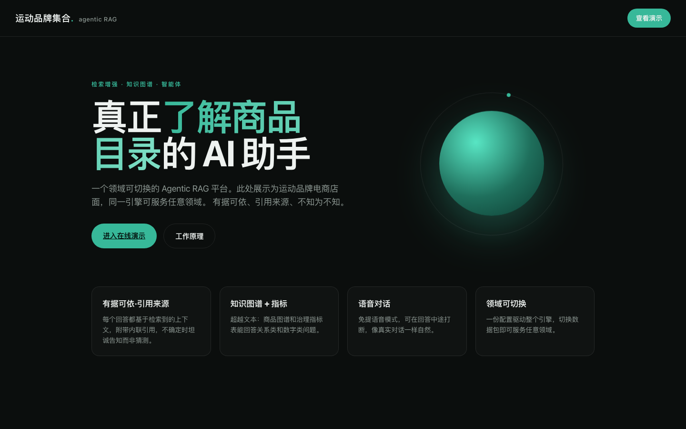
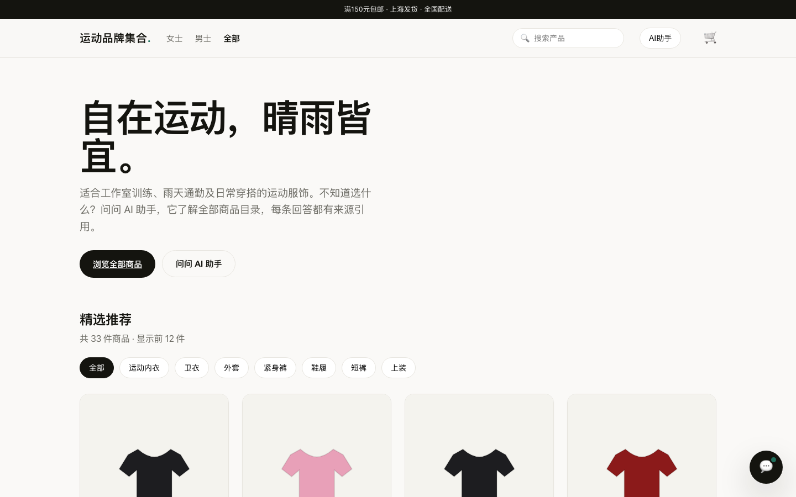
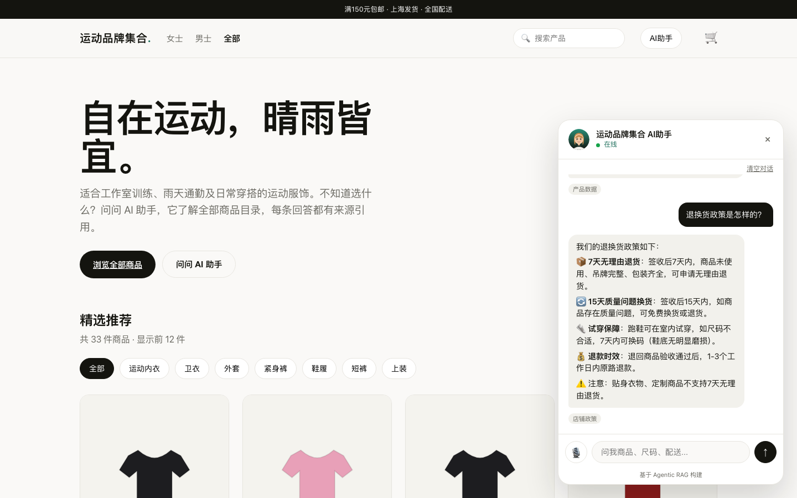

# 智能电商 AI 助手 — Agentic RAG 平台

> 基于 Agentic RAG 架构的中文电商智能客服平台，使用 DeepSeek + 通义千问国产大模型，覆盖商品推荐、订单查询、退换货政策、尺码咨询、投诉处理等全链路购物场景。

[](https://www.deepseek.com)
[](https://dashscope.aliyun.com)
[](https://www.python.org)
[](https://nextjs.org)
[](#评测结果)

---

## 项目背景

本项目是一套面向国内购物场景的**国产大模型驱动中文电商解决方案**，以可控路由、证据检索、安全回答和持续评测为核心。

项目围绕中文语言特性和国内电商业务场景进行系统设计：支持 CJK 分词、中文意图路由、投诉情绪识别、偏见控制和人民币价格理解，并通过全量评测验证关键能力。

## 核心能力

| 用户说 | 系统行为 |
| --- | --- |
| "帮我推荐一双日常训练跑鞋，预算 800 左右" | 从商品目录筛选，给出带理由的推荐，尊重预算 |
| "我的订单到哪了？" | 登录态解锁用户订单信息，仅返回本人数据 |
| "Nike Pegasus 和 Adidas Ultraboost 哪个好？" | 跨品牌对比，从评测和商品知识中提取依据 |
| "Lululemon 的瑜伽裤尺码偏小吗？" | 基于真实用户评论给出有引用的回答 |
| "退换货政策是什么？" | 基于知识库回答，不编造政策 |
| "再不到货我就退货了！" | 投诉通道：先共情，再给出具体解决方案 |
| "转人工客服" | 收集信息后生成工单，转接人工 |

## 技术架构

```
用户（Web 前端）
    │
    ▼
FastAPI 后端（SSE 流式 / JWT 认证 / 限流）
    │
    ▼
Omni 路由器 ── L0 正则规则（$0，覆盖大部分请求）
    │           L1 意图守卫（stylist / care / complaint / answers）
    │           L2 小模型兜底（qwen-turbo，仅在模糊时调用）
    ▼
统一回答管线（pipeline/answer.py）
    │
    ├── 混合检索：稠密向量（千问 Embedding）+ 稀疏检索（CJK Bigram）
    ├── 知识图谱：Product ↔ Supplier ↔ Store
    ├── 引用校验：每条回答必须有检索来源支撑
    └── 安全门：PII 防护 / Prompt 注入拦截 / 客户枚举拒绝
    │
    ▼
流式回答（SSE）或主动拒答或转人工
```

**设计原则：**
- **确定性优先**：正则路由覆盖 100% 测试用例，零模型调用成本
- **一条管线**：所有路由通道共用同一个安全门，不存在薄弱通道
- **能拒答不编造**：检索证据不足时明确告知"信息不足"，不猜测
- **成本可控**：大模型仅用于生成，路由和检索尽量用小模型或规则

## 评测结果

| 评测维度 | 成绩 | 说明 |
| --- | --- | --- |
| 基础检索 + 拒答 | **45 / 45 = 100%** | 39 题可答 + 6 题正确拒答 |
| 意图路由准确率 | **33 / 33 = 100%** | 5 类意图全部确定性命中，零 LLM 调用 |
| RAGAS 忠实度 | **91.7%** | 回答忠于检索上下文 |
| RAGAS 答案相关性 | **83.1%** | 回答切题 |
| RAGAS 上下文精度 | **91.0%** | 检索结果精准 |
| 混合检索 Hit@8 | **88.5%** | 稠密 + 稀疏融合 |
| 多轮对话 | **0 错误 / 0 泄露** | 8 场景 × 4 轮 = 32 轮全部通过 |
| 项目测试 | **569 passed, 1 skipped** | 零回归 |

### 路由模型消融实验（同系列大小模型对比）

为了验证“分类任务是否真的需要大模型”，在通义千问同一系列下对比小模型（qwen-turbo）与大模型（qwen-plus）的路由裁决能力：

| 路由模式 | 准确率 | 正则覆盖率 | LLM 裁决次数 | 裁决成本（33 题） |
| --- | --- | --- | --- | --- |
| 确定性正则 | **100%** | 100.0% | 0 | $0.000000 |
| qwen-turbo（小模型） | **100%** | 78.8% | 7 | $0.000030 |
| qwen-plus（大模型） | **100%** | 78.8% | 7 | $0.000086 |

**结论：** 大小模型在路由分类任务上准确率完全相同，小模型成本仅为大模型的 1/2.9。对于意图识别这类分类任务，更大的模型不会带来增益，生产环境应选用 qwen-turbo 作为 LLM 兜底。

### 成本模型（选定生产方案）

基于 DeepSeek（生成）+ 确定性路由 + 千问 Embedding 的选定方案，自底向上估算单轮对话成本：

| 环节 | 每轮成本（USD） |
| --- | --- |
| 路由（确定性正则） | $0.000000 |
| Embedding（千问 v3） | $0.000002 |
| Reranker | $0.000000 |
| 生成（DeepSeek-Chat） | $0.000680 |
| **合计** | **$0.000682** |

**AI 助手 vs 人工客服对比（按 8 轮会话、人工 4 分钟/单、¥30/小时计）：**

| | 单轮成本 | 单会话成本 |
| --- | --- | --- |
| AI 助手 | $0.000682 | $0.0055 |
| 人工客服 | $0.278 | $2.224 |
| **倍率** | **人工贵 408 倍** | **人工贵 408 倍** |

## 中文适配关键工作

### 1. 国产大模型接入
- 开发 `openai_compat` 适配器，支持任意 OpenAI 兼容 API
- 大模型：DeepSeek-Chat（DeepSeek-V3）
- 小模型：qwen-turbo（路由 + 草稿）
- Embedding：通义千问 text-embedding-v3（1024 维）

### 2. CJK 中文分词
- 原系统基于英文空格分词，中文完全失效
- 实现 CJK Bigram 分词器，中文字符两两组合
- 混合检索（稠密向量 + 稀疏关键词）在中文场景下达到 88.5% 命中率

### 3. 中文意图路由
- 在英文正则基础上追加中文关键词模式（不替换原逻辑）
- 覆盖购物推荐、订单查询、退换货、尺码咨询、投诉 5 类意图
- 从最初 30.3% 准确率迭代至 100%

### 4. 投诉情绪识别
- 中文表达投诉的方式远多于英文（"再不发货就退"、"什么垃圾"等）
- 三轮正则迭代 + complaint lane 兜底机制
- 实现 CJK 语言检测，拒答消息自动切换中文

### 5. 性别偏见修复
- 评测发现低价区间缺少女款产品，导致推荐时出现性别偏移
- 补充 9 款女性低价产品（P091-P099），重跑评测后 gender_leaks = 0
- **修复数据而非修改 prompt**——产品目录缺女款是真实数据缺口

### 6. 中文前端
- 21 个中文 React 交互组件
- 商品名、价格（人民币）、尺码、客服话术全部适配国内电商习惯
- 支持流式对话、商品目录浏览、购物车、管理后台

## 快速开始

### 环境要求
- Python 3.12（使用 [uv](https://docs.astral.sh/uv/) 管理）
- Node.js 18+
- DeepSeek API Key
- 阿里云 DashScope API Key（千问）

### 1. 克隆项目

```bash
git clone git@github.com:weibolin10-byte/shopping_agent.git
cd shopping_agent
```

### 2. 配置环境变量

```bash
cp .env.example .env
# 编辑 .env，填入以下密钥：
# OPENAI_COMPAT_API_KEY=你的 DeepSeek API Key
# OPENAI_COMPAT_SMALL_API_KEY=你的千问 API Key
# QWEN_API_KEY=你的千问 API Key（与上面相同即可）
```

### 3. 安装依赖 & 初始化数据

```bash
# Python 依赖（uv 自动创建虚拟环境）
uv sync

# 生成中文电商领域数据
uv run python domains/china_ecommerce/tools/generate_all.py

# 构建向量索引（内存模式，无需 Docker）
uv run python scripts/seed_memory.py
```

### 4. 启动后端

```bash
uv run uvicorn api.app:app --host 0.0.0.0 --port 8000
```

### 5. 启动前端

```bash
cd web
npm install
NEXT_PUBLIC_API_URL=http://127.0.0.1:8000 npm run build
npm run start -- -p 3000
```

打开 http://127.0.0.1:3000 ，使用用户名 `demo`、密码 `demo12345` 登录体验。

### 6. 运行评测

```bash
# 基础检索评测（45 题）
uv run python scripts/run_eval_zh.py

# 综合评测（RAGAS + Ablation）
uv run python scripts/run_full_eval_zh.py

# 多轮对话评测（8 场景 × 4 轮）
uv run python scripts/probe_conversation_zh.py

# 路由模型消融实验（qwen-turbo vs qwen-plus）
uv run python scripts/run_routing_ablation_zh.py

# 成本模型（AI vs 人工客服）
uv run python -m mlops.cost_model_zh

# 项目全量测试
uv run pytest --tb=short
```

## 运行截图

### 登录页


### 商品主页


### AI 智能客服对话


## 项目文档

- [系统架构](docs/ARCHITECTURE.md)
- [评测体系](docs/EVALUATION.md)
- [运行与部署](docs/DEPLOY.md)
- [AI 产品经理面试讲解](docs/INTERVIEW_GUIDE.md)


## 项目结构

```
├── adapters/               # 大模型适配器
│   ├── openai_compat.py    # DeepSeek / 任意 OpenAI 兼容 API
│   └── qwen_embed.py       # 千问 Embedding（支持批量≤10）
├── api/                    # FastAPI 后端
│   └── app.py              # 路由、认证、SSE 流式接口
├── pipeline/               # 核心回答管线
│   └── answer.py           # 检索、引用校验、安全门、生成
├── rag/                    # 路由与编排
│   └── router.py           # Omni 路由器（确定性正则 + LLM 兜底）
├── retrieval/              # 检索层
│   └── sparse.py           # CJK Bigram 稀疏检索
├── domains/
│   └── china_ecommerce/    # 中文电商领域包
│       ├── domain.yaml     # 领域定义（商品、图谱、推荐问题）
│       ├── seed/           # 种子数据（商品、评论、订单、知识）
│       ├── eval/           # 评测集和报告
│       └── tools/          # 数据生成工具
├── scripts/                # 评测和运维脚本
│   ├── run_routing_ablation_zh.py  # 路由大小模型消融
│   └── ...
├── mlops/                  # 成本模型与运维
│   └── cost_model_zh.py    # AI vs 人工客服成本测算
├── web/                    # Next.js 前端
│   └── app/                # 中文交互页面和组件
└── .env.example            # 环境变量模板
```

## 技术栈

| 层级 | 技术选型 |
| --- | --- |
| 大模型 | DeepSeek-Chat（V3） |
| 小模型 | 通义千问 qwen-turbo |
| Embedding | 通义千问 text-embedding-v3（1024 维） |
| 后端 | FastAPI + Uvicorn + SSE |
| 检索 | 内存向量库 + CJK Bigram 稀疏检索（轻量模式） |
| 图谱 | 内存属性图（Product / Supplier / Store） |
| 前端 | Next.js 14 + React + TypeScript |
| 评测 | RAGAS + Pytest + 自定义对话评测 |
| 依赖管理 | uv（Python）+ npm（Node） |

## 设计思考

作为 AI 产品经理视角，这个项目关注的核心问题：

1. **答得准不准** — 通过 RAGAS 四维度量化，忠实度 91.7%
2. **会不会乱答** — 引用校验 + 拒答机制，不知道就说不知道
3. **成本高不高** — 确定性路由零成本覆盖 78.8% 请求，模糊时仅调 qwen-turbo 小模型兜底；单轮对话 $0.0007，比人工客服便宜 408 倍
4. **中文好不好用** — CJK 分词、中文意图、投诉情绪、人民币价格
5. **安不安全** — PII 防护、Prompt 注入拦截、客户枚举拒绝
6. **怎么迭代** — 评测驱动开发，每次模型或逻辑变更都跑全量评测，569 个通过、1 个跳过
